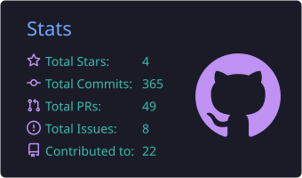
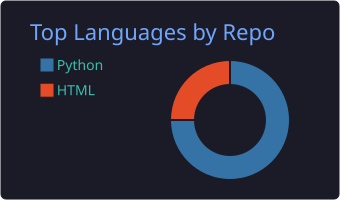
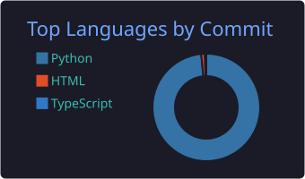
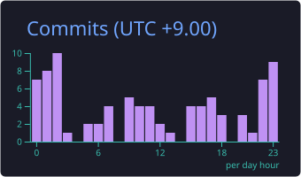

## Featured Projects

| Project | Description |
|---|---|
| [**ARGOS**](https://github.com/Patrick-SCH03/kohyoung-ai-competition-2026-argos) | AOI inspection planning solver for PCB inspection machines · 3rd place at the 4th Koh Young AI Competition |
| [**Student Council AI Agent**](https://github.com/Patrick-SCH03/Student-Council_AI_Agent) | Student Council Regulation AI Assistant · multi-agent RAG that answers with clause-level citations, in use at Inha University |
| [**Ko-Nect**](https://github.com/Patrick-SCH03/MOVE-AI-CHALLENGE-2026) | Same-day KTX delivery where citizens and KTX trains relay parcels · MOVE-AI Challenge 2026, KORAIL track |

## Team

| Team | About |
|---|---|
|  [**Inha-United@home**](https://github.com/inha-united-athome) | Inha University's RoboCup@Home team, building a domestic service robot · [Team site](https://inha-united.github.io/Home2026/) |

## Awards

| Competition | Result | Work |
|---|---|---|
| **4th Koh Young AI Competition** ICCAS 2026 · Sapporo, Japan |  [Certificate](https://github.com/Patrick-SCH03/kohyoung-ai-competition-2026-argos/blob/main/assets/certificate.jpg) | [**ARGOS**](https://github.com/Patrick-SCH03/kohyoung-ai-competition-2026-argos) plans where the inspection camera shoots and in what order. 3rd of 13 teams, 5.4% lower score than Koh Young's baseline solver with 18% fewer shots |

## Open Source Contributions

**26 merged pull requests** across 6 open-source projects

| Project | Contribution | PRs |
|---|---|---|
| [**NVIDIA Isaac Lab**](https://github.com/isaac-sim/IsaacLab) | Fixed math utility, terrain generation, reset noise and point cloud filtering bugs |  |
| [**Microsoft Agent Governance Toolkit**](https://github.com/microsoft/agent-governance-toolkit) | Fixed inverted SLO compliance, double-counted trust decay, a rate-limit token leak and broken provider fallbacks |  |
| [**Chrome DevTools MCP**](https://github.com/ChromeDevTools/chrome-devtools-mcp) | Moved tool tests from a real browser to mocks (1.7 s → 0.03 s per Lighthouse test) and fixed two input edge cases |  |
| [**Toss es-toolkit**](https://github.com/toss/es-toolkit) | Fixed Lodash compatibility bugs found by differential testing against Lodash |  |
| [**A2A Python SDK**](https://github.com/a2aproject/a2a-python) | Added warnings for AgentCards missing fields the A2A spec marks REQUIRED |  |
| [**Pydantic AI**](https://github.com/pydantic/pydantic-ai) | Updated the contributor guide to match how `make install` sets up pre-commit |  |

## GitHub Stats

  

<picture>
  <source media="(prefers-color-scheme: dark)" srcset="https://raw.githubusercontent.com/Patrick-SCH03/Patrick-SCH03/output/github-contribution-grid-snake-dark.svg" />
  
</picture>

